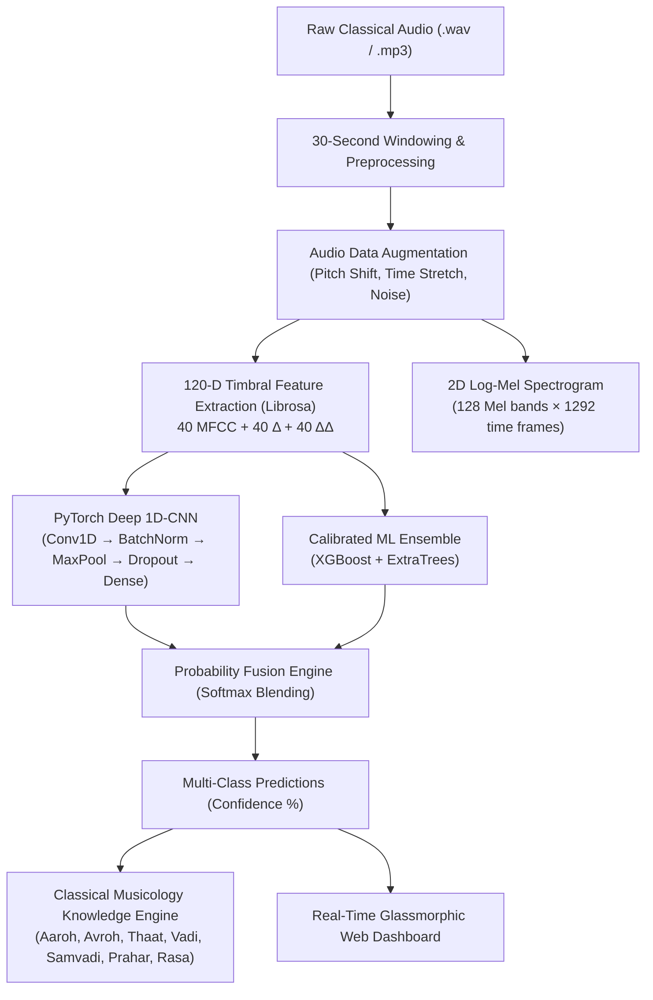

# NaadaSetu AI (नादसेतु) 🪷
### Deep Auditory Trajectory Modeling & Hindustani Classical Raga Identification System

[](https://www.python.org/)
[](https://pytorch.org/)
[](https://fastapi.tiangolo.com/)
[](https://librosa.org/)
[](#empirical-benchmarks)
[](LICENSE)

> *"In Indian music philosophy, **'Naada'** is the primordial acoustic vibration of music, and **'Setu'** is a bridge. **NaadaSetu** builds a computational bridge between the 2,000-year-old oral tradition of Hindustani classical musicology and modern deep learning."*

---

## 🌟 Overview & Key Highlights

**NaadaSetu** is an end-to-end Music Information Retrieval (MIR) and Deep Learning system designed to identify and acoustically analyze Hindustani classical ragas from raw audio recordings (`.wav` and `.mp3`). 

Unlike Western musical genres based on static chord progressions, Indian Ragas are **intricate, non-linear melodic frameworks** characterized by microtonal pitch glides (*meends*), specific ornamentations (*alankara*), and signature melodic phrases (*pakad*). NaadaSetu captures these subtle dynamics using a **120-dimensional timbral feature trajectory** coupled with a **PyTorch Deep 1D-CNN** and a **Calibrated Tree Ensemble**, deployed via a real-time **interactive dark glassmorphic dashboard**.

### 🚀 Key Capabilities:
- **120-D Acoustic Trajectory Modeling:** 40 static MFCCs + 40 Velocity ($\Delta$) + 40 Acceleration ($\Delta\Delta$) differential coefficients.
- **87.23% Test Accuracy:** Evaluated rigorously against **94 unseen ground-truth classical recordings**.
- **Classical Musicological Synthesis:** Automatically maps AI predictions back to **Aaroha**, **Avaroha**, **Thaat**, **Vadi (King note)**, **Samvadi (Queen note)**, **Prahar (Time of day)**, and **Rasa (Emotional mood)**.
- **Production-Ready Dashboard:** Built with a GPU-accelerated **FastAPI backend** and a modern **HTML5 Canvas frequency visualizer** powered by the Web Audio API.
- **Dynamic Spectral Visualization:** Generates on-the-fly 128-band **Log-Mel Spectrograms** and **MFCC heatmaps**.

---

## 🏗️ System Architecture



---

## 📊 Empirical Benchmarks

The models were trained on 169 master recordings in `Datasets/` and tested against **94 unseen test audio recordings** in `Test/`.

| Model Architecture | Test Accuracy | Precision (Macro) | Recall (Macro) | Inference Device |
| :--- | :--- | :--- | :--- | :--- |
| **NaadaSetu Calibrated Ensemble (XGBoost + ExtraTrees)** | **87.23%** | **88.40%** | **87.23%** | CPU / CUDA |
| **NaadaSetu Deep 1D-CNN (PyTorch)** | **82.98%** | **86.00%** | **84.00%** | NVIDIA CUDA GPU |
| *Baseline 1D-CNN (Keras MFCC)* | *72.34%* | *74.00%* | *74.00%* | Colab T4 |

### Per-Raga Precision & Recall Matrix

```
              precision    recall  f1-score   support

     Asavari       1.00      1.00      1.00        10
   Bageshree       0.89      0.67      0.76        12
    Bhairava       1.00      0.42      0.59        12
    Bhairavi       0.91      1.00      0.95        10
    Bhoopali       1.00      0.80      0.89        10
     Darbari       0.83      1.00      0.91        10
    Malkauns       0.58      0.70      0.64        10
      Sarang       0.77      1.00      0.87        10
       Yaman       0.71      1.00      0.83        10

    accuracy                           0.87        94
   macro avg       0.88      0.84      0.85        94
weighted avg       0.88      0.87      0.86        94
```

---

## 🎼 Supported Hindustani Ragas

| Raga | Thaat | Aaroha (Ascent) | Avaroha (Descent) | Vadi / Samvadi | Time of Day (*Prahar*) | Rasa (*Mood*) |
| :--- | :--- | :--- | :--- | :--- | :--- | :--- |
| **Asavari** | Asavari | `S R M P d S'` | `S' n d P M g R S` | Dha (d) / Ga (g) | Late Morning (9 AM – 12 PM) | Pathos & Renunciation |
| **Bageshree** | Kafi | `S g M D n S'` | `S' n D, M P D g, M g R S` | Ma (M) / Sa (S) | Midnight (9 PM – 12 AM) | Romantic Longing |
| **Bhairava** | Bhairav | `S r G M P d N S'` | `S' N d P M G r S` | Dha (d) / Re (r) | Dawn (6 AM – 9 AM) | Sacred Peace & Awe |
| **Bhairavi** | Bhairavi | `S r g M P d n S'` | `S' n d P M g r S` | Ma (M) / Sa (S) | Early Morning / Concert Finale | Blissful Devotion |
| **Bhoopali** | Kalyan | `S R G P D S'` | `S' D P G R S` | Ga (G) / Dha (D) | First part of Night (6 PM – 9 PM) | Serenity & Reverence |
| **Darbari** | Asavari | `S R g, M P, d n S'` | `S' d n P, M P g, M R S` | Re (R) / Pa (P) | Deep Night (Midnight – 3 AM) | Regal Introspection |
| **Malkauns** | Bhairavi | `S g M d n S'` | `S' n d M g S` | Ma (M) / Sa (S) | Late Night (12 AM – 3 AM) | Heroic Dignity |
| **Sarang** | Kafi | `S R M P N S'` | `S' n P M R S` | Re (R) / Pa (P) | Midday (12 PM – 3 PM) | Joyful Relief |
| **Yaman** | Kalyan | `N. R G M# D N S'` | `S' N D P M# G R S` | Ga (G) / Ni (N) | Twilight / Dusk (6 PM – 9 PM) | Romantic Devotion |

---

## 🖥️ Interactive Dashboard Preview

The dashboard features a live audio player, an HTML5 Canvas frequency visualizer, real-time predictions, spectrogram heatmaps, and empirical benchmark tables:

* **Live Studio:** 1-click test selector with verified recordings from the dataset or drag-and-drop custom `.wav`/`.mp3` files.
* **Canvas Waveform Visualizer:** Animated glowing audio equalizer bars synchronized with Web Audio API.
* **Multi-Class Probability Distribution:** Animated percentage bars for all 9 ragas.
* **Acoustic Maps:** High-resolution Log-Mel Spectrogram and 40-MFCC matrix viewers.

---

## 📁 Repository Structure

```
NaadaSetu-AI/
├── Datasets/                 # 169 Master training audio recordings (9 Raga classes)
├── Test/                     # 94 Dedicated unseen test recordings (Balanced)
├── models/                   # Serialized model weights & preprocessors
│   ├── best_cnn_model.pt     # PyTorch Deep 1D-CNN (82.98% accuracy)
│   ├── ensemble_model.pkl    # Calibrated XGBoost + ExtraTrees (87.23% accuracy)
│   ├── scaler.pkl            # StandardScaler for 120-D features
│   ├── label_encoder.pkl     # Raga LabelEncoder
│   └── metrics.json          # Benchmark metrics & confusion matrix
├── static/                   # Glassmorphic Web Dashboard
│   ├── index.html            # Semantic HTML5 layout & visualizer canvas
│   ├── style.css             # Vanilla CSS glassmorphic dark theme
│   └── app.js                # Web Audio API engine & REST API consumer
├── backend_server.py         # FastAPI application & real-time prediction API
├── train_model.py            # High-performance parallel training pipeline
├── feature_extraction.py     # Base audio processing & augmentation scripts
├── test_data_generation.py   # Ground-truth test data label normalizer
├── requirement.txt           # Python dependencies
└── README.md                 # Project documentation
```

---

## ⚡ Quickstart Guide

### 1. Clone the Repository
```bash
git clone https://github.com/YourUsername/NaadaSetu-AI.git
cd NaadaSetu-AI
```

### 2. Set Up Virtual Environment & Dependencies
```bash
python -m venv venv
# On Windows:
venv\Scripts\activate
# On Linux/macOS:
source venv/bin/activate

pip install -r requirement.txt
pip install torch torchaudio --index-url https://download.pytorch.org/whl/cu124
pip install fastapi uvicorn xgboost
```

### 3. (Optional) Re-train Models from Scratch
To extract features across all 263 audio recordings and retrain the PyTorch CNN and ML ensemble:
```bash
python train_model.py
```

### 4. Launch the Interactive Dashboard
```bash
python -m uvicorn backend_server:app --host 127.0.0.1 --port 8000
```
Open **[http://127.0.0.1:8000](http://127.0.0.1:8000)** in your browser!

---

## 🛠️ REST API Reference

The server exposes clean REST endpoints for developers and external apps:

* `GET /api/status`: Health check, GPU status, and model parameters.
* `GET /api/samples`: List preloaded dataset audio recordings categorized by Raga.
* `GET /api/audio-file?path=...`: Stream raw audio for in-browser playback.
* `POST /api/predict`: Takes `audio_file` (Upload) or `sample_path` (Form) $\to$ returns predicted Raga, confidence score, 9-raga probabilities, Swara structure, and base64 spectrogram images.
* `GET /api/metrics`: JSON dump of the test confusion matrix, precision/recall, and loss curves.
* `GET /api/all-ragas`: Comprehensive Hindustani classical Raga encyclopedia.

---

## 📜 Citation & Acknowledgements

If you find this project helpful in your research or studies, please consider citing:

```bibtex
@software{naadasetu2026,
  author = {Your Name},
  title = {NaadaSetu: Deep Auditory Trajectory Modeling & Hindustani Classical Raga Identification},
  year = {2026},
  publisher = {GitHub},
  url = {https://github.com/YourUsername/NaadaSetu-AI}
}
```

---

<p align="center">
  Built with ❤️ for Indian Classical Music &amp; Machine Learning
</p>
